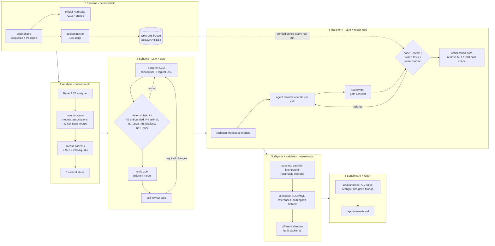

# mini-AMP: AI-assisted Postgres → MongoDB application modernizer

mini-AMP takes a real **Node.js + Express + Sequelize + PostgreSQL** app and modernizes its data layer to
**MongoDB**. It produces a working MongoDB version of the app and **verifies** that it behaves the same as the original.

The target app is [TonyMckes/conduit-realworld-example-app](https://github.com/TonyMckes/conduit-realworld-example-app),
a "Conduit" Medium clone (MIT license, © TonyMckes; vendored unchanged in `vendor/original/`). Only the backend data
layer is converted. The API contract is not changed.

**Core idea:** this is a deterministic pipeline with LLM agents only at the steps that need judgment. It follows the
split used by MongoDB's Application Modernization Platform (AMP) and the
[AptMQL-Bench](https://arxiv.org/abs/2610.02770) paper. Deterministic code analyzes the app, migrates every record
and decides whether data or behaviour changed. The LLM designs the schema and rewrites and repairs the code.

## Architecture



## How to run

Prerequisites: Docker, Node 22, Python 3.12+, and a Groq API key in `.env` (`GROQ_API_KEY=...`; free tier is enough).

```bash
docker compose up -d --wait                       # Postgres 16 + MongoDB 8.2 replica set (rs0)
python3 -m venv .venv && .venv/bin/pip install psycopg[binary] pymongo requests pytest python-dotenv
(cd vendor/original && npm install --workspace backend)   # the original app
(cd analyzer && npm install)
.venv/bin/python -m pipeline all                  # every stage; resumes after a crash or rate-limit pause
.venv/bin/python -m pipeline status               # where am I?
```

Commands for individual stages: `baseline`, `analysis`, `schema`, `transform`, `migrate`, `benchmark`, `report`
(each is `python -m pipeline <stage>`). Unit tests: `.venv/bin/python -m pytest tests/unit -q` and `(cd analyzer && npm test)`.

### Demo in under 2 minutes (after a full run)
```bash
docker compose up -d --wait
.venv/bin/python -m pipeline.seed --articles 1000           # deterministic data in Postgres
.venv/bin/python -m pipeline.migrator --fresh               # -> MongoDB, then run it again to see the resume skip
.venv/bin/python -m pipeline.checks                         # the 3 post-migration checks
(cd apps/mongo-backend && PORT=3002 MONGO_DB=conduit JWT_KEY=amp_local_dev_jwt_key node index.js &)
curl -s 'localhost:3002/api/articles?limit=1' | head -c 400; echo
```

## Results

See **[reports/results.md](reports/results.md)**. It is generated only from artifacts of real runs and includes the
command that reproduces each number.

## Repository map
| Path | What |
|---|---|
| `pipeline/` | Python orchestrator (state machine), LLM client, guard, migrator, checks, differential, stages |
| `analyzer/` | Babel-based static analyzer plus its tests |
| `tests/official/` | gothinkster/realworld Hurl suite (frozen) |
| `tests/characterization/` | golden master recorded from the original app (frozen) |
| `tests/unit/` | unit tests for the deterministic parts |
| `analysis/` `design/` | Stage 2 and Stage 3 outputs (inventory, access patterns, schema, review) |
| `apps/mongo-backend/` | the generated MongoDB version of the backend |
| `logs/` | every LLM call (`llm_calls.jsonl`, transcripts) and every repair iteration (`transform/`) |
| `reports/` | results and raw measurements |

Docs: [DESIGN.md](DESIGN.md) · [DECISIONS.md](DECISIONS.md) · [INTERVIEW_NOTES.md](INTERVIEW_NOTES.md) ·
[design/schema.md](design/schema.md) · [design/paper_notes.md](design/paper_notes.md)
